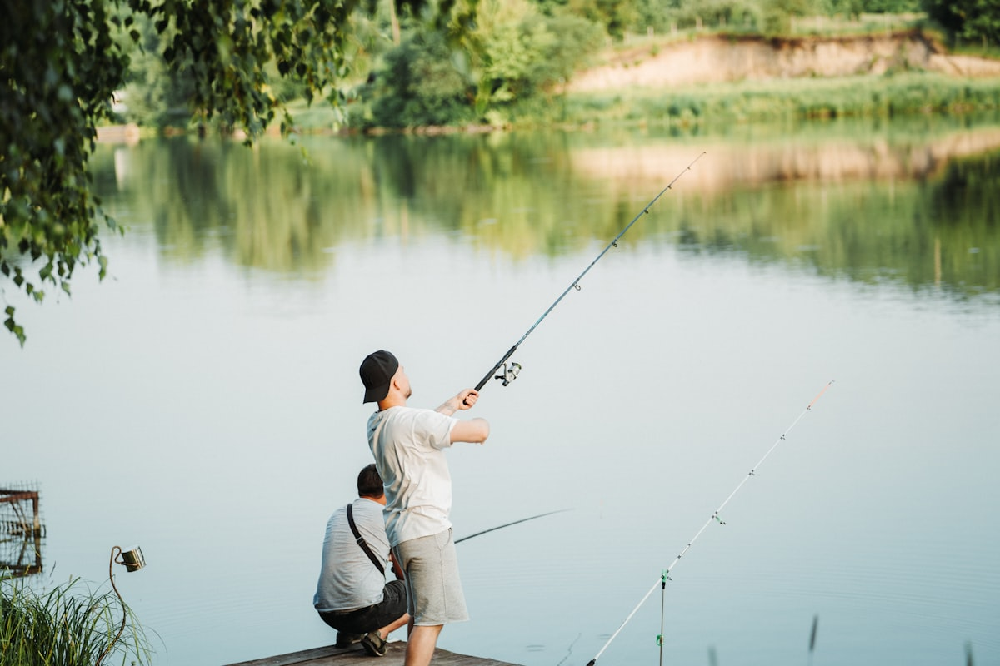
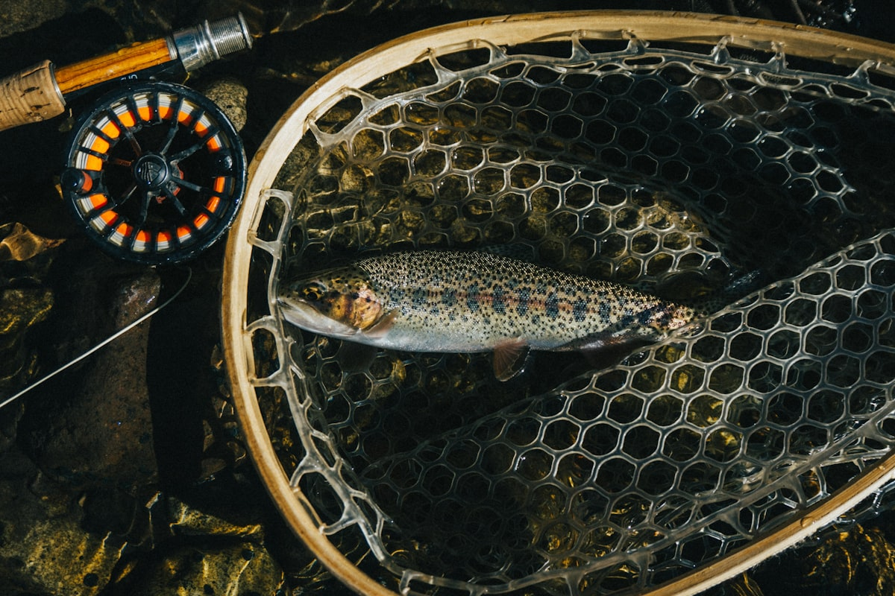

You've got a 22-inch brown trout in your net. Water is 64°F, current is steady, fish is still green. Your hands are wet. You want to log it, photograph it, and get it back in the water — and you're already counting seconds in your head. That internal clock isn't anxiety. It's good instincts. The science behind catch and release best practices comes down to one uncomfortable truth: most released fish that die, die because of what happened in the 30 seconds after the hook came out. This post covers what actually moves the needle on fish survival rate — and how faster logging fits into that equation.

## The 30-Second Air Exposure Rule

Research on largemouth bass, rainbow trout, and bonefish consistently points to air exposure as the single biggest predictor of post-release mortality. The threshold that shows up repeatedly in fisheries literature: 30 seconds out of water at normal summer temperatures. Beyond that, survival rates drop in a non-linear way — the damage compounds, not accumulates.

At 78°F water, a bass held out for 60 seconds is not twice as stressed as one held for 30. It's significantly more compromised — labored equilibrium, lactic acid buildup, immune suppression that can kill the fish two days later where you'll never see it.

The 30-second rule isn't a hard cliff, but it's a useful mental anchor. If you can't do everything — unhook, photograph, log — in under 30 seconds, the fish goes back in the water first. Full stop.

## Water Temperature Changes Everything

The 30-second rule assumes moderate water temperatures. In reality, the threshold compresses fast as water warms. At 85°F, dissolved oxygen is already low and the fish is already under metabolic stress before you even touch it. At those temps, 15 seconds of air exposure can do what 45 seconds would do at 65°F.

This is why logging water temperature isn't just data nerd behavior. When you look back at your catch history and notice your summer bass survival felt off — more fish swimming erratically on release, more belly-up floaters — water temp is usually the variable that explains it.
<figure class="inline-image"><figcaption>Photo by <a href="https://unsplash.com/@khodzinskyi?utm_source=castlog&utm_medium=referral" rel="noopener nofollow">Vitalii Khodzinskyi</a> on Unsplash</figcaption></figure>
Practical thresholds to keep in mind:

- Below 60°F: Fish are cold, metabolism is slow, they're more resilient. You have a little more margin.
- 60–75°F: The standard window. 30 seconds is your target.
- Above 75°F: Treat every second like it costs something. Minimize air exposure, skip the grip-and-grin, wet your hands before the fish comes out of the water.
- Above 82°F: Seriously consider whether you should be targeting those species at all. Catch and release ethics includes knowing when not to fish.

## What Actually Damages Fish (Beyond Air Exposure)

Air exposure gets the headlines, but there are three other factors that compound the damage or work independently.

**Dry hands and dry nets.** A fish's slime coat is its immune system. One grip with dry hands removes more slime than 20 seconds of air exposure. Rubber nets or knotless mesh, wet hands before contact — these aren't optional refinements for the conservation-minded. They're baseline.

**Improper support.** Holding a large fish vertically by the jaw — the so-called lip hang — torques the jaw joint and spine. A 5-pound walleye held vertically for a photo is not a fish you're releasing in good condition. Horizontal support, one hand under the belly, keeps internal organs where they belong.

**Exhaustion before landing.** A fish fought to total exhaustion on light tackle takes far longer to recover than one landed quickly on appropriate gear. Matching your tackle to the fish isn't just sporting — it's part of ethical fishing. A 10-minute fight on 6-lb test for a 4-pound bass is harder on the fish than a 90-second fight on 12-lb.

## The Logging Problem Nobody Talks About

Here's where I have to be honest about something I built CastLog to fix. The standard fishing app workflow — open app, navigate to log entry, tap species, tap size, add location, add photo, add notes, save — takes somewhere between 45 seconds and two minutes with wet hands on a phone screen. I've done it. I've also watched anglers skip logging entirely because the fish was already back in the water before they finished.

The result is a data gap. You lose the record of that fish, which means you lose the pattern data that would have told you something useful three months from now.
<figure class="inline-image"><figcaption>Photo by <a href="https://unsplash.com/@jjmills1?utm_source=castlog&utm_medium=referral" rel="noopener nofollow">Jarrett Mills</a> on Unsplash</figcaption></figure>
CastLog logs a catch in 3 taps, under 5 seconds — species, size, location pre-filled from GPS, with voice input if your hands are too wet to type. The fish goes back in the water on time. The data gets captured. Those two things stopped being in conflict.

Fishbrain is the app most serious anglers have tried. It's a capable platform, but the logging flow wasn't built around the 30-second constraint. And at $80 a year behind a paywall, with offline reliability issues in the places worth fishing, it solves a different problem than the one you have standing in a river with a brown trout in your net.

## Recovery: The Step Most Anglers Rush

You got the fish back in the water in under 30 seconds. Good. Now slow down.

A fish that swims away immediately isn't always a fish that survives. Lactic acid buildup from the fight can cause delayed mortality — the fish swims 20 feet, lists, and dies. Proper revival matters.

Hold the fish upright in the current, facing upstream. Let water flow through the gills. Don't pump the fish back and forth — that's an old myth that can actually damage gill tissue. Hold it steady and let the current do the work. Wait for the fish to kick out of your hands with authority, not just drift away.

In still water with no current, move the fish slowly in a figure-eight pattern to push oxygenated water across the gills. The revival is complete when the fish rights itself and holds position without your support.

That moment — when the fish takes off on its own — is the one worth logging. Not just for the data, but because it's the whole point.

---

If you've felt the friction of trying to log a fish while it's in your net, CastLog is live on the App Store — free forever for the basics, and built around the 30-second constraint, not against it. If you're on Android, join the Android waitlist for Q3 2026. The fish will thank you for the speed!
