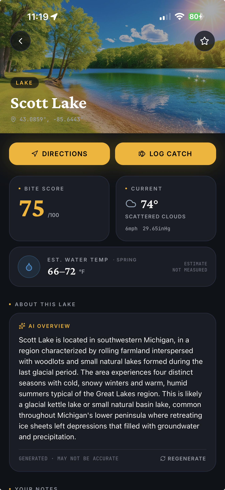

I've been on Michigan lakes in mid-November when the water looks wrong. Not iced over, not summer green — just a dull, mixed color, sometimes with that faint bottom-of-the-lake smell on the wind. The first time I noticed it I thought something was dying. What I was smelling was the lake mixing. That's fall turnover, and it's one reason late fall walleye fishing can feel like the fish vanished overnight — or showed up in a spot that was dead two weeks ago.

## What actually happens when a lake turns over

In summer, a deeper lake often stacks into layers. [University of Nebraska–Lincoln Extension](https://water.unl.edu/article/lakes-ponds-streams/fall-turnover-physical-look-lakes/) describes a warm upper layer (the epilimnion), a cooler, often oxygen-poor bottom layer (the hypolimnion), and a thin thermocline in between that keeps those layers from mixing.

In fall, the surface cools until it is about as dense as the water below. Then wind can mix the whole column. That's turnover. Oxygen from the surface reaches the bottom, and nutrients and decomposing organic matter from the bottom get stirred through the lake. UNL Extension also explains why some lakes smell in the fall, and why a turnover that happens too quickly can drop oxygen low enough to cause a fish kill. I treat that as a reason to watch the water in front of me, not last month's summer pattern.

Shallow ponds and some small lakes may barely stratify. Deeper natural lakes and reservoirs in the northern U.S. usually do. If you fish both, don't expect them to "flip" on the same weekend.

## Where late-fall walleye actually show up

This part gets oversimplified. Turnover is not a switch that moves every fish into eight feet of water. State agencies are more careful than that, and so is the fishing.

[Minnesota DNR](https://www.dnr.state.mn.us/gofishing/how-catch-walleye.html) notes that success is often highest in May and June in shallow or semi-shallow water near shore, that walleye move deeper as summer water warms, and that in late summer and early fall some fish gradually move back toward the shoreline while others stay in deep water. That's the useful frame: after the lake mixes, you may find fish in more than one place on the same water.

[Michigan DNR](https://www.michigan.gov/dnr/education/michigan-species/fish-species/walleye) says prime feeding times are early morning and evening, and that walleye feed actively all winter. In fall, jigging spoons in deep water is a popular technique on Michigan waters. That "deep water" line matters — turnover does not automatically pull every fish shallow.

[Wisconsin DNR](https://dnr.wisconsin.gov/topic/Fishing/outreach/yearoffishing.html) describes walleye catch rates picking up again in September and October, with October's cooler weather still offering strong walleye opportunities, and notes that September and October are typically when walleye put on much of their growth for the year. Wisconsin also flags fall movements of walleye up rivers, which is worth a look if you fish connecting rivers and not just inland lakes.

In mid-to-late November I start with what the lake is doing, not with a single depth I read about. If the water has that mixed look and the surface has cooled hard, I'll spend part of the day on classic fall structure — points, gravel, remaining weed edges — and part of it checking whether fish are still holding deeper. I keep a short log either way so the next trip isn't a guess.

## Tactics that match the season, not a rumor

I don't carry a secret bait for turnover — just a short list that matches what agencies recommend and what I can fish well when the wind comes up.

Minnesota DNR's fall suggestion is straightforward: troll or cast small hard-plastic baits — the ones that look like perch or other prey fish — near shallow or semi-shallow weedlines, gravel bars, and points, and keep trolling speeds slow, in the one-mile-per-hour range. That's a search presentation. I'd rather move slowly along those edges than camp on one summer hump out of habit.

Michigan's fall spoon bite in deep water is the other half of the same week. If the edges are quiet, I'll vertical jig long enough to find out whether the school never left deep water. Michigan DNR also notes that slow trolling at a variety of depths matters, because even though walleye are often associated with the bottom, the most active fish are sometimes suspended.

Low light still matters. I plan the best hours around morning and evening, and I check the current fishing guide for the water I'm on. Seasons, size limits, and closed areas change; a fall pattern isn't a free pass.

What I won't do is invent a magic temperature or a universal depth and call it science. Water temp after turnover is useful because it's changing, and because [your own history at each temperature band](/blog/water-temp-bass-fishing-guide/) is more honest than a number copied from a forum. Walleye aren't bass, but the habit is the same: log the temp you actually used, then see what your catch rate does as the lake cools toward winter.

## Log the mix, not just the fish

The week after a lake flips is when a sloppy journal costs you the most. The shoreline bite and the deep bite can both be real, on the same lake, two days apart. If I only remember the one fish I kept, I lose the conditions that separated a flurry from a blank.

I want four things in the log, every time:

- When I caught it — clock time, not "evening-ish"
- Where, in my own terms — point, weed edge, basin, river mouth — with the pin private
- What I threw and how I moved it
- What the water and weather were doing — surface temp if I have it, air temp, wind, pressure

CastLog is built for that moment when your hands are cold and you don't want to type. Voice logging takes a sentence. Manual logging is three taps and under five seconds, and it works offline. Conditions can come in automatically, so I'm not thumbing through a weather app in the wind.

<figure class="inline-image"><figcaption>The CastLog lake view on Scott Lake, Michigan: Bite Score, current weather, and a water-temperature estimate. The air temperature, spring temp band, and green shoreline in this screenshot are a warmer-season example of the UI — not late-fall readings.</figcaption></figure>

On that screen, Bite Score is a 0–100 read on the day's conditions — weather, pressure trend, water temp, and season — not a promise that fish will bite. I use it before I drive, then I trust what I actually catch and log. If you want the fuller breakdown of how to read that number, I walked through it in [Bite Score explained](/blog/lake-intelligence-bite-score/).

The payoff shows up later. After enough catches, [pattern recognition](/blog/fishing-pattern-recognition-ai/) is just your history stacked: which points produced at which temps, whether the spoon bite showed up on a falling afternoon, whether 1-mph trolling only worked on a particular wind. CastLog starts surfacing those correlations after about 25 catches, from your water, not a generic lake.

## Carry the record into early ice

Michigan DNR's line that walleye feed actively all winter is why I don't treat the last open-water trip as the end of the season. The mix you're watching now is the same water you'll drill in a few weeks, if ice comes in clean. A late-fall log of temperature, structure, and time of day is a better first-ice plan than a memory of one good evening.

I still fish this period for the usual reasons: fewer boats, colder hands, and fish putting on weight before winter. Log the turnover week as it actually unfolds — shallow, deep, or both — and you'll have something to go on when the lake locks up.

---

If you're heading out after the lake mixes, take the notes while the fish is still in the net. Download CastLog on the App Store — logging is free forever for the basics, and it takes under 5 seconds. Android testing is now open too. A late-fall pattern is only useful if you can find it again.
