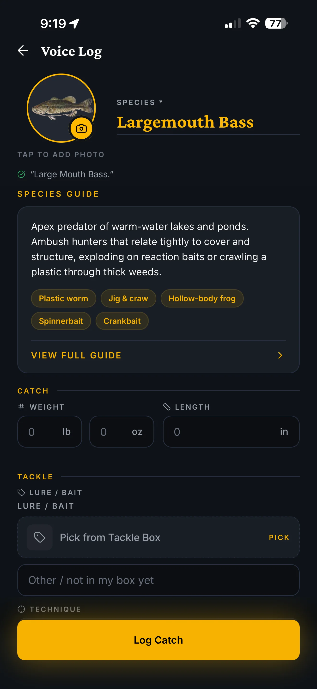

Every late November some group chat in Michigan starts asking how thick should ice be for fishing, and whether it is thick enough yet. I have stood on a small northern lake with a spud in my hand and that number in my head, and I have also turned around. The [Michigan DNR ice safety page](https://www.michigan.gov/dnr/education/safety-info/ice) is the line I use, not a forum chart. Your safety is your responsibility. There is not a reliable "inch-thickness" to determine if ice is safe.

That is the whole post if you only keep one sentence. The rest is how I decide anyway — without pretending CastLog or a photo of someone else's hole can tell you the ice will hold.

## Late November, not a calendar you can trust

This is the week first ice starts to feel possible, not guaranteed. I will not name a Michigan lake as iced, and I will not invent a freeze-up date for yours.

NOAA's Great Lakes lab is useful for the physics, even on a pond. Ice typically starts in early December, with a lot of year-to-year scatter, and [first forms near shorelines and in protected or shallow bays](https://www.glerl.noaa.gov/pubs/fulltext/2019/20190003.pdf) before growing offshore. Deep, long-fetch water holds heat and gets mixed by wind.

Small, shallow, northern inland lakes have even less stored heat than a Great Lakes bay. That is why, in late November, I look at those waters first and leave the big lakes alone. If you are still on open water, that is not a miss. I would rather keep walking a [November steelhead river](/blog/november-steelhead-fishing-michigan/) than force a hole on ice that has not decided what it is yet.

## There is no magic thickness

People want a number. Michigan does not give you one.

DNR tells you to [test thickness and quality with a spud, needle bar, or auger](https://www.michigan.gov/dnr/education/safety-info/ice). Their [ice fishing page](https://www.michigan.gov/dnr/things-to-do/winter/ice-fish) says check with local bait shops that the spot is adequately covered — then it still sends you back to the safety page. Local knowledge is a starting point, not a measurement under your next step.

The Coast Guard makes the same point on the Great Lakes: [never assume the ice is safe, even if others are on it](https://content.govdelivery.com/accounts/USDHSCG/bulletins/279abdc). A bucket on the ice is not a load rating. Tracks and yesterday's hole are not today's ice.

## How I actually check: spud, auger, and a tape

DNR describes the tools the way I carry them. A [spud is a long-shank chisel](https://www.michigan.gov/dnr/education/safety-info/ice) for chipping a hole when the ice is not too thick. An auger is the corkscrew with a cutting blade. Their fishing page is blunt: [always test the ice with a spud](https://www.michigan.gov/dnr/things-to-do/winter/ice-fish).

Minnesota DNR publishes a how-to I follow as a method, not as Michigan law. Ice is never 100% safe. [Drive a chisel into the ice, then measure](https://www.dnr.state.mn.us/safety/ice/check-ice-thickness.html). Hook the tape on the bottom edge and read it at the surface. Do not judge thickness by how easily the chisel or drill breaks through — that happens so fast it is easy to overestimate. Walking with a chisel is not a substitute for measuring often. Start near shore. On early ice they note that if you are walking on four to six inches, you will likely find thinner spots on the same lake.

That is why I do not drill one hole at the ramp and stroll to the point. Minnesota also writes that [ice is seldom the same thickness over a single body of water](https://www.dnr.state.mn.us/safety/ice/thickness.html); it can be two feet in one place and one inch a few yards away. If the spud punches through, I am done. If it does not, I still open a hole and read the tape.

## Clear ice, white ice, snow, and slush

Thickness without quality is a bad number.

Michigan DNR: strongest ice is [clear with a bluish tint](https://www.michigan.gov/dnr/education/safety-info/ice). Weak ice is melted and refrozen snow and looks milky. Stay off ice with slush on top. Slush ice is only half as strong as clear ice and means the ice is not freezing from the bottom. Ice covered by snow should always be considered unsafe. Snow insulates, slows freezing, hides thin ice, and a recent snowfall can melt what you already had.

Minnesota's formation page adds the language anglers actually use. [Clear ice — sometimes called blue ice](https://www.dnr.state.mn.us/safety/ice/ice-formations-conditions.html) — typically forms at the start of the season on calm water and can look blue or black when you look down. White ice is snow that melted on the sheet and refroze, about half as strong as new clear ice. Honeycomb ice, the late-season rotten stuff, does not get a thickness chart. If it is honeycombed, stay off.

National Weather Service winter safety says the same: white or "snow" ice is [about half as strong as new, clear ice](https://www.weather.gov/safety/winter-ice-frost), so double any guideline. Stay off if you see cracks, holes, or breaks; flowing water around the edges, just below, or over the top; or ice that looks like it thawed and refroze. First ice here is often the clear kind after a still, cold night. The first snow that lands on it is when I get suspicious.

## Current, shoreline, debris, bubblers, ridges

A good reading in the middle of a bay does not travel to the creek mouth.

Michigan DNR: the [stronger the current, the more likely the ice will give to open water](https://www.michigan.gov/dnr/education/safety-info/ice). If there is ice on the lake but water around the shoreline, be extra cautious. Avoid ice with logs or brush sticking through it. Dock bubblers and de-icers make nearby ice unsafe. A sudden cold front can crack ice within a half-day. A warm spell may take several days to weaken it. Ice weakens with age.

The Coast Guard's Great Lakes bulletin is the inlet list I use on drowned river mouths: [currents around narrow spots, bridges, inlets, and outlets are always suspect](https://content.govdelivery.com/accounts/USDHSCG/bulletins/279abdc). Stay away from cracks, seams, pressure ridges, slush, and darker ice.

Minnesota describes [pressure ridges](https://www.dnr.state.mn.us/safety/ice/ice-formations-conditions.html) as heaves along a crack that can form in hours and hide open water or a thin flooded shelf. They also flag stream inlets, culverts, and anything that soaks up sun: rocks, logs, docks, bridges. I do not drive or snowmobile onto first ice. Michigan's fishing page adds a visual I actually use: [steer clear of dark spots or snow that looks discolored](https://www.michigan.gov/dnr/things-to-do/winter/ice-fish).

## A buddy, ice picks, and a plan

DNR's fishing rules are not extras. [Never fish alone](https://www.michigan.gov/dnr/things-to-do/winter/ice-fish). Tell someone where you are going and when you expect to return. Take a lifejacket, ice picks, and a cell phone. Dress in layers, wear cleats, pack spare gloves.

The safety page lists the same kit: [lifejacket, ice picks or claws, and a two-way device that actually gets a signal](https://www.michigan.gov/dnr/education/safety-info/ice). Coast Guard adds a whistle, a waterproof VHF or locator beacon — because [cell signal can be limited](https://content.govdelivery.com/accounts/USDHSCG/bulletins/279abdc) — and two ice awls or even screwdrivers. Wear bright clothing. Share the plan on shore.

I wear the picks around my neck, not in the sled. I walk with someone, spaced so we do not load the same weak spot. If my partner will not go, I do not go.

If you go through, DNR's steps are: [remain calm](https://www.michigan.gov/dnr/education/safety-info/ice). Do not strip your winter clothes. Turn toward the direction you came from. Dig the picks in, kick, and slide forward. Roll away. Get dry. Call 911 if you are disoriented, shivering uncontrollably, or showing other hypothermia signs.

## Other agencies print inch charts. Read them as charts, not permission

[Minnesota DNR thickness guidelines](https://www.dnr.state.mn.us/safety/ice/thickness.html) are for new, clear ice only. Under 4 inches: stay off. 4 inches: ice fishing or other activities on foot. They say ice is never 100% safe, they do not measure your lake, and white ice means you double those numbers.

[National Weather Service ice recreation guidance](https://www.weather.gov/safety/winter-ice-frost) is similar and tells you to check with your state DNR: stay off ice less than 2 inches; 4 inches or more for ice fishing, skating, and walking; at least 5 inches for snowmobiles and ATVs. Those are general guidelines, not a Michigan DNR table, and not a promise.

I do not use the vehicle rows at first ice. If Minnesota's own how-to says four-to-six-inch ice still hides thinner spots, a four-inch reading at the access is not a green light to wander. Michigan's position governs me here: no reliable inch-thickness, test as you go, you own the decision.

## What I log, and what CastLog is not

CastLog cannot tell you ice is safe. It will not. I will not let a pin or a voice note talk me onto a sheet I have not punched.

What the journal is good for is next November. After I measure, I write a personal note: date, lake in my own words, where I stood, tape reading, clear or white or slush, air temp, snow on the ice, whether I walked or turned around. That is not a public ice report. Spots stay [private by default](/blog/private-fishing-spots-burning/). I am not publishing a thickness someone else will treat as permission.

The same log takes the fish if I catch one. [Catch-and-release handling](/blog/catch-and-release-best-practices/) still applies when the air is brutal and the hole is small. Get the fish back down fast.

Phones die in the cold and a lot of these lakes have no bars. That is why [offline logging](/blog/best-offline-fishing-app/) matters more in late November than in July. Voice logging is how I keep gloves on: [say the catch, or say the ice check](/blog/voice-logging-fishing-catches/), and put the phone back inside the jacket.

<figure class="inline-image"><figcaption>CastLog Voice Log confirm: the app has already parsed the spoken species. This is a catch-log screen, not an ice-thickness reading. Gloves stay on. The ice decision still happens with a spud, not with the phone.</figcaption></figure>

I use that confirm screen for the fish. For the ice, the useful field is the note after the tape: four inches of clear ice at the first hole, slush in the creek mouth, went home. Next year I have my own history instead of a guess. The app does not walk out for you.

---

If you have ever stood at the ramp in late November arguing with a group text about how thick ice should be for fishing, that is the friction. Michigan's answer is that there is no magic number. Check it yourself, or stay off. Download CastLog from [castlogapp.com](https://castlogapp.com/). Free core journal, voice logging and export. Angler Pro is optional, and a catch logs in seconds. On Android, [drop your email for an invite](https://castlogapp.com/#android-invite). Write the ice down. Do not let the app talk you onto it.
