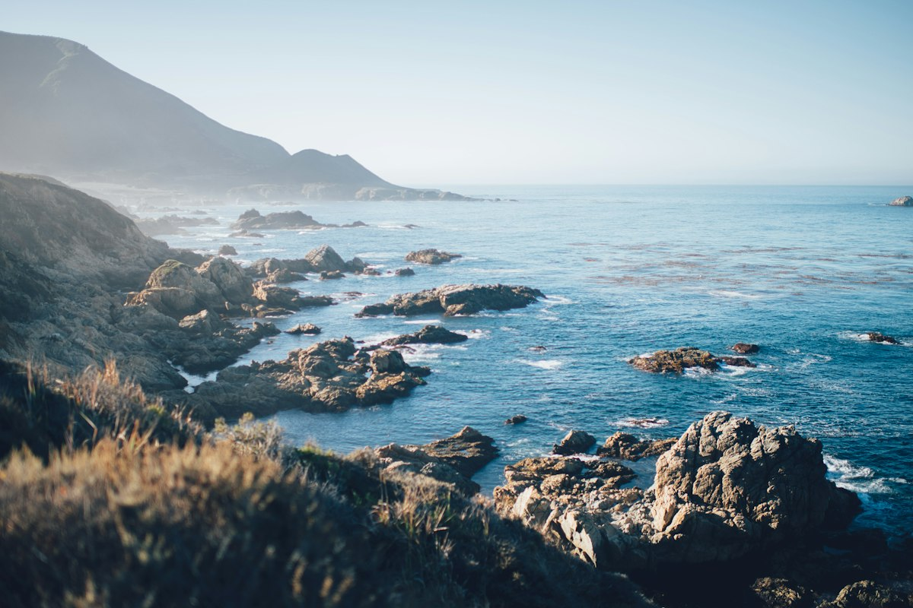
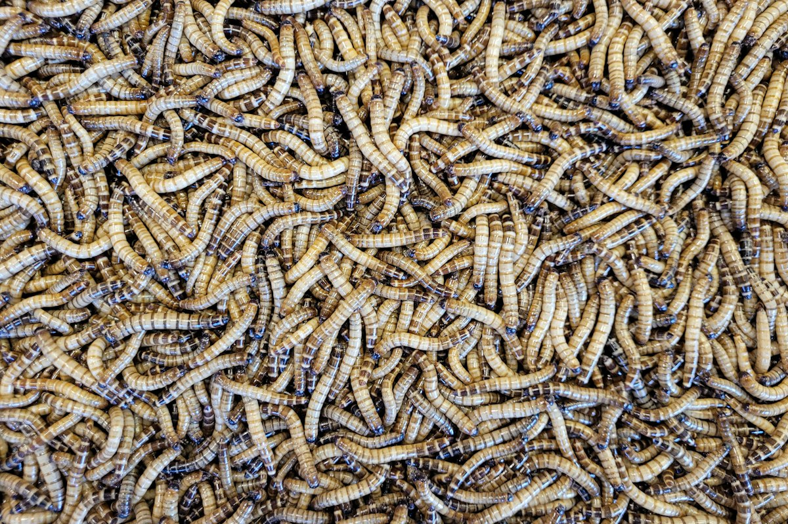

The wind had a bite to it, and the ramp was empty except for one guy trailering a walleye rig. Late November, and the lake that felt like a carnival in September was shut down. I idled out anyway, because the bass had not left. They had only moved.

The flats I pounded in October were dead. The fish were tight to the steep breaks, where the bottom falls away fast, eating when the light was low.

Here is the late fall bass fishing pattern I trust now, and the few details worth writing down so you can find those fish again next week.

## Where late fall bass actually sit

By the time the walleye guys are done with their open-water push, the bass have already moved. They do not vanish when the leaves are gone. They compress. The flats that held scattered fish in early fall go quiet, and the bites I still get come off steeper breaks, where a flat ends and the bottom falls away in a short run instead of a long taper.

I am not chasing a magic depth. A number from my lake will lie to you on yours. What travels is the shape. I idle the edge until the graph shows a hard angle, not a gentle slide, and I fish the top of that angle first, then the face, then the base. Steep breaks bass treat that edge as a highway and a holding spot at once. They slide up to feed and drop back without crossing a long stretch of dead water.

Cold water bass are lazy about horizontal moves and picky about cover on the vertical. A stump, a rock spine, or one hard spot on that face will outfish a blank stretch of the same break. If the wind is pushing bait onto one side of a point, that is where I start.
<figure class="inline-image"><figcaption>Photo by <a href="https://unsplash.com/@goian?utm_source=castlog&utm_medium=referral" rel="noopener nofollow">Ian Schneider</a> on Unsplash</figcaption></figure>
## Smaller baits, slower retrieves

This is where I used to waste the most time. I would throw the same crankbait that crushed in September and blame the lake when it did not move. Cold water bass do not chase the way they did six weeks ago. The strike zone shrinks, and a bait that looks small and easy wins more often than a bait that looks impressive.

I downsize to a compact swimbait, a finesse jig, or a small jerkbait worked with long pauses. The retrieve is a slow drag along the break, not a burn. I keep the bait in contact with the angle or just off it, and I give the fish time to make up its mind.

If I am fishing a jig, I am not hopping it like summer. I am crawling it, feeling for the rock or the wood, and letting it sit when I hit something that is not mud.

Color matters less to me than profile and speed. In stained water I want something I can track. In clear water I go subtler.

The mistake is speed. If you are on fish and not getting bit, cut the retrieve in half before you change lakes.
<figure class="inline-image"><figcaption>Photo by <a href="https://unsplash.com/@nathan_cima?utm_source=castlog&utm_medium=referral" rel="noopener nofollow">Nathan Cima</a> on Unsplash</figcaption></figure>
## Low light still does the work

Late fall bass fishing is not an all-day grind if you pay attention to the clock. The best windows I get are the first hour after dawn and the last hour before dark, plus a gray, windy midday when the sun never really gets on the water.

Bright high sun and a flat calm afternoon is when I reposition, eat, or go home. The fish are still on the break. They are just not eating in the open.

I treat those windows like appointments. I am on the best steep break I know before the sun clears the trees, and I do not spend the first twenty minutes hunting new water. New water is for the dead middle of the day, when a missed spot costs less. When the light drops again, I go back to the spot that showed life in the morning, even if it was only one fish or a few marks tight to the bottom.

Wind matters more than comfort in November. A little chop on the steep side of a point breaks up the light and pushes bait. I would rather fish a breezy break than a glass-calm pocket just because the pocket feels easier.

## Working one break instead of roaming

The temptation in late fall is to cover water, because the lake feels empty and moving feels like progress. On steep breaks, roaming is how I miss the few fish that are willing. I pick one break with the right angle, hard bottom, and some wind, and I fish it like it owes me an answer.

First pass is a moving bait, slow, parallel to the break so the lure stays in the strike zone longer. I am looking for a fish that will come up. If that pass is blank, I turn around and drag a jig or a small creature bait down the face, casting from shallow to deep so the bait falls along the angle instead of swinging off it.

Contact matters. If I lose the bottom, I am fishing the wrong part of the cast.

I give a good break forty minutes before I leave it, longer if I have seen bait or marked fish. One follower, one short strike, one decent mark, and that is enough to stay. A dead graph and no contact after a full pass both ways, and I move to the next steep spot, not back to the flat out of habit.

## Write down the water, not just the fish

The pattern falls apart if all I remember is that we got a few on the north end. Water temp drops a little and the same break fishes differently. The retrieve that worked Tuesday is too fast on Saturday. If I do not write it down while my hands are still cold, I fish the story I invent later instead of the lake.

What I log is boring, and that is the point.

- Water temperature
- Where on the break the fish were: top, face, or base
- Bait size and how slow I had to fish it
- Time of day, and whether the wind was on that bank

That is enough to watch the slide week to week instead of starting over every Saturday.

I built CastLog because logging with wet hands used to mean six taps and a phone I did not want out, so I quit writing things down. A catch has to take under five seconds, voice included, or it never gets recorded. Those breaks rarely have a signal, so the log has to work offline, and the spot stays private. The payoff is seeing, across a few cold weeks, that the bites stacked on steep rock as the water dropped.

If you've felt this frustration too — a real break, a short window, and nothing written down once your hands warm up — download CastLog on the App Store. Android testing is now open — drop your email for an invite. Late fall does not give you many bites. You might as well keep the ones that tell you where to start tomorrow.
