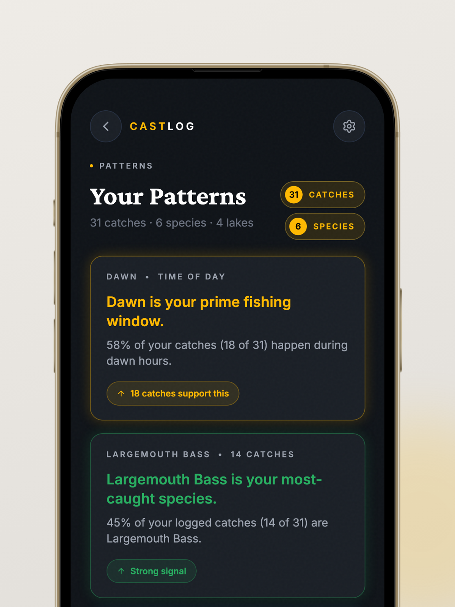

The first week of ice is when I want to be on panfish, and it is also when I am most likely to talk myself onto ice that has not earned it. Early ice panfish — bluegills and crappies, mostly — are still on a fall feed. That only helps if you are still on top of the sheet.

[Michigan DNR](https://www.michigan.gov/dnr/education/safety-info/ice) is the line I use, same as last week: your safety is your responsibility, and there is not a reliable "inch-thickness" that tells you ice is safe. Check often. Carry picks. [Never fish alone](https://www.michigan.gov/dnr/things-to-do/winter/ice-fish). CastLog cannot tell you the ice will hold. I wrote that out in [first ice and ice thickness](/blog/first-ice-michigan-ice-thickness/). Read that before you drill for gills.

## Early ice is not one Monday on the calendar

I will not name a lake as iced, and I will not invent a freeze-up date for yours. Upper Midwest ice arrives in pieces.

NOAA's Great Lakes lab is useful even if you fish a pond. Ice typically starts in early December, with a lot of year-to-year scatter, and [first forms near shorelines and in protected or shallow bays](https://www.glerl.noaa.gov/pubs/fulltext/2019/20190003.pdf) before growing offshore. Shallow, northern inland lakes have even less stored heat than a Great Lakes bay. That is why, in late November and early December, I look north and small first and leave the big, windy basins alone.

If your water is still open, that is not a miss. When it does lock, I still start near shore with a spud, measure, and turn around if the tape or the color of the ice is wrong.

Check the current [Michigan Fishing Guide](https://www.michigan.gov/dnr/things-to-do/fishing/fishing-regulations) before you keep a fish. Seasons, possession rules, and special regulations change by water. I am not going to paste bag limits here.

## Where bluegills go first: green weeds, then the edge

Michigan DNR is plain about winter bluegills: they [remain active all winter](https://www.michigan.gov/dnr/education/michigan-species/fish-species/bluegill), and they favor cover — weed beds, submerged logs, drop-offs. They usually stay relatively shallow. First ice is that habit under a lid, not a new species.

Minnesota DNR's ice-fishing page is the map I use when the sheet is new. There is [no one answer](https://www.dnr.state.mn.us/gofishing/ice-fishing-bluegill.html) for where you will find sunfish. Location varies with lake shape, clarity, vegetation, oxygen, and food. The places you are more likely to catch fish still have a shape: shallow weedy flats, vegetated structure, points that jut into deeper water, narrows, humps, and deeper holes.

The weed part is the one I will not skip. Sunfish are often in and around underwater vegetation, especially cabbage-like growth and coontail. If those weeds have died and turned brown, they are less likely to hold fish. I look for green. I fish just over the tops of the weeds or along the edges rather than burying a jig in them.

Wisconsin DNR's winter bluegill note matches what I drill first: [shallow bays about four to eight feet deep](https://dnr.wisconsin.gov/topic/Fishing/icefishing/IcefishTechniques.html), a teardrop tipped with insect larvae, gently jigged. Their year-round tips add that ice anglers find fish [among weeds](https://dnr.wisconsin.gov/topic/Fishing/outreach/hookyourcatch.html), including sand/weed borders, sometimes in only a couple of feet of water. I treat those depths as a starting search, not a promise on your lake.

What I actually walk: the inside of a weedy bay that froze first, then the first turn or pocket in that weed edge, then the flat that dumps toward a break. If the weeds are gone, I look for wood or the first drop off the flat. I do not start the week over the deepest hole because a forum said "basin."

## Crappies: the same neighborhood, then they suspend

Black crappie in Michigan are [weed-oriented](https://www.michigan.gov/dnr/education/michigan-species/fish-species/crappie) compared with white crappie, which show up more around brush and timber. Both school. Find one, you have generally found a bunch. After the spawn they move deeper and tend to suspend. Under early ice, that habit is already in play.

Minnesota DNR starts crappies at the [mouths of shallow bays that lead to deeper water](https://www.dnr.state.mn.us/gofishing/ice-fishing-crappie.html). After ice forms, the shallows cool faster. Crappies slide toward deeper water to conserve energy and find forage. They also use drop-offs, shelves, points, narrows, and weedy flats. They typically are not glued to the surface or the bottom. They suspend somewhere in between, often a little deeper than the bluegills on the same break.

That is the sequence I fish. Weeds and the adjacent flat for mixed panfish. As the day goes on, I walk holes from that edge out over the first basin, watching for fish off the bottom. Wisconsin DNR notes that crappies [remain active all winter](https://dnr.wisconsin.gov/topic/Fishing/outreach/hookyourcatch.html) and that ice anglers do best near submerged structure, with small teardrops and grubs as winter bait. I keep a minnow option. They have larger mouths than bluegills. Michigan says so, and Minnesota says start with a medium jig and do not be afraid of a small spoon.

Low light matters more on clear water. Minnesota DNR: success on clear lakes is often best at [dawn and dusk](https://www.dnr.state.mn.us/gofishing/ice-fishing-crappie.html); stained water can have a real day bite. Michigan's ice-fishing page says the same window for panfish — [dawn until mid-morning, and late afternoon until sundown](https://www.michigan.gov/dnr/things-to-do/winter/ice-fish). I plan the crappie walk for the edges of the day. I do not invent a moon-phase catch rate.

Minnesota also flags barotrauma on crappies brought up fast from water deeper than about twenty feet. Early ice, I am usually not in that water yet. If I am, I decide before the fish is on the ice whether it is a keeper.

## Small jigs, light line, and enough holes

I keep the box small. Michigan's ice page is the tackle list: short, limber rods, [light line](https://www.michigan.gov/dnr/things-to-do/winter/ice-fish), teardrops or flies tipped with wax worms, spikes, wigglers, or minnows. Jig, or fish still. Start near bottom and work up until you find them.

Minnesota fills in the sizes I actually tie. Bluegills eat insects and small crustaceans, so start small — they list common sunfish jigs down in the 1/16- to 1/64-ounce range. Successful anglers often fish [2- to 4-pound-test](https://www.dnr.state.mn.us/gofishing/ice-fishing-bluegill.html) because bluegills inspect a bait before they eat it. Plastics and live bait both belong in the same hole: a tiny plastic to call fish, a wax worm or wiggler on the other rod if the lake allows it. If the deadstick out-fishes the jig, I am moving too much.

Crappie gets a slightly bigger jig, a small spoon, or a minnow head. Light line still. Soft mouths. Minnesota's hook-set note is "enough oomph, not much more."

Electronics earn their sled space because panfish are not always on the bottom. A flasher tells you whether the weeds are still standing, whether anything is in the column, and whether the mark rose to the bait. Minnesota DNR says anglers with a camera or sonar have a [clear advantage](https://www.dnr.state.mn.us/gofishing/ice-fishing-bluegill.html) at deciding where sunfish are — and are not. I drop to the depth I am marking, not to a number I liked last December.

Hole-hopping is the other half. Michigan: fish move less in the dead of winter, and [the more holes you cut and try, the better your chances](https://www.michigan.gov/dnr/things-to-do/winter/ice-fish). Minnesota's quiet-water rule: drill the holes in one session, then fish, especially in the shallows. I drill a line from inside the weeds, across the edge, onto the flat, and one or two over the first drop. Then I walk. A school of crappies will leave, which is why Minnesota says to punch nearby deeper and shallower holes so you can find them again.

I log which of those holes produced. Not a public pin. The note is "second hole past the weed edge, four feet down, chartreuse, 3:40 p.m."

## Keep the big bluegills, and keep the spot

Minnesota DNR says it without a sermon: you can support bluegill conservation by [releasing large sunfish](https://www.dnr.state.mn.us/gofishing/ice-fishing-bluegill.html), which matter for keeping a population from stunting. I eat some panfish. I do not fill a bucket with the ones that took years to get that shoulder. Check your local rules anyway. Some waters have special regulations on purpose.

The other ethic is quieter. First ice on a weedy bay is a small place. A pin, a livestream, or a "secret spot" photo with a shoreline tree in it burns it. CastLog keeps spots [private by default](/blog/private-fishing-spots-burning/). That is table stakes. The useful part is that I can still write the hole down.

## What I log on early ice, with gloves on

A panfish day only teaches the next one if the notes are specific. I want:

- Clock time, not "afternoon" — the low-light window is the whole point for crappies
- Depth, and whether the fish were on bottom, in weeds, or suspended
- Weed or structure in my own words: green cabbage, brown junk, sand/weed edge, first drop
- Lure and color, and whether it was plastic, live bait, or a spoon
- Air temperature and pressure if I have them, because next December I want to know whether the bite died after the front
- Which holes produced, kept private

Voice logging is how I keep gloves on: [say the catch](/blog/voice-logging-fishing-catches/) and put the phone back inside the jacket. Manual logging is three taps, [under five seconds](/blog/log-a-catch-in-under-5-seconds/). A lot of these lakes have no bars, and phones die in the cold, which is why [offline logging](/blog/best-offline-fishing-app/) matters more in late November than in July.

Conditions can fill in so I am not thumbing a weather app with a wet index finger. [Bite Score](/blog/lake-intelligence-bite-score/) is a pre-trip read of pressure and temperature — useful in the driveway, not a reason to skip the spud. After enough catches, [pattern recognition](/blog/fishing-pattern-recognition-ai/) is just your own early-ice history: which color on which weed edge at which hour. It is not a study someone else ran on your lake.

<figure class="inline-image"><figcaption>CastLog Patterns: an example of the view that clusters your own logs. The numbers on this screen are sample data from the app listing, not ice-fishing statistics and not a claim about panfish catch rates.</figcaption></figure>

I use that screen the way I use a paper log in March: to see whether dawn actually showed up in my notes. It does not tell me the ice is safe. Next year I have my own first-ice panfish week, written down, instead of a guess.

---

If you have ever stood over a new sheet of ice with a bucket of gills and no idea which hole, which depth, or which color did it, that is the friction. Download CastLog from [castlogapp.com](https://castlogapp.com/). Free core journal, voice logging and export. Angler Pro is optional, and a catch logs in seconds. On Android, [drop your email for an invite](https://castlogapp.com/#android-invite). Write the panfish down. Check the ice yourself.
